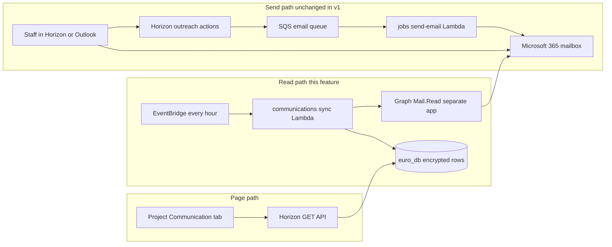
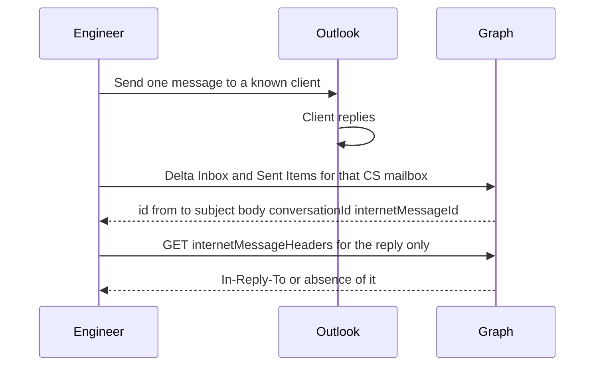
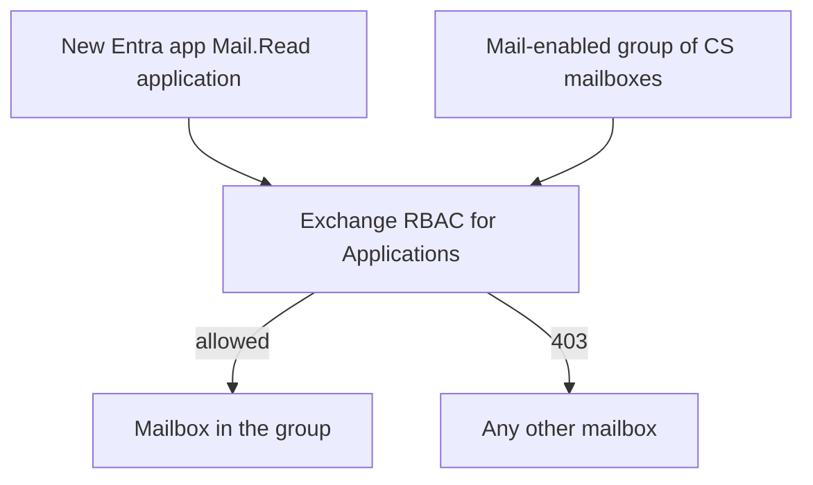

# Technical plan: project email visibility
Companion to [prd-project-email-communications.md](prd-project-email-communications.md).
This is the build plan for Amit’s design: **poll Microsoft Graph, store matched mail encrypted in euro_db, read that store from Horizon**. HubSpot is not in this plan.
**Assumptions until discovery questions in the PRD are closed**
- Version 1 is **client ↔ client-service** on the project page. Expert threads reuse the same job in version 2.
- Exchange RBAC is the **security boundary** (which mailboxes the app can open). Horizon’s client-service tables are the **match set** (which messages to keep).
- One message that matches two open projects is stored twice and marked shared.
- Poll interval is one hour.
- The job does **not** run inside the Next.js request path. Horizon never calls Graph when a person opens the tab.
- Local JSON / delegated-token experiments are spikes. They are not this design.
---
## 1. Technologies
| Layer | Technology | Why this one |
| --- | --- | --- |
| Mail system of record | Microsoft 365 mailboxes (Inbox + Sent Items) | That is where client and expert mail already lives. |
| Read API | Microsoft Graph `v1.0` | Delta query on a mailbox folder. Application permission `Mail.Read`. |
| Identity for the job | Microsoft Entra ID app registration, **client credentials** (`@azure/msal-node` or the Lambda equivalent) | An hourly job has no logged-in user. Do not reuse the Horizon user’s delegated token. |
| Scope limit | Exchange Online **RBAC for Applications** on a mail-enabled security group | `Mail.Read` application permission is tenant-wide unless RBAC restricts which mailboxes the app can open. |
| Existing send path (unchanged in v1) | Horizon → SQS (`SQS_EMAIL_QUEUE_URL`) → jobs Lambda → Graph `sendMail` | Outreach already works. This feature only adds a read path. |
| Job host | AWS Lambda in the **jobs** repo, trigger **EventBridge** schedule `rate(1 hour)` | Same place as other background work. Isolated from the web task so a Graph outage cannot take down Horizon. |
| Secrets | AWS Secrets Manager, injected into the Lambda (and not into the browser) | App client secret and the encryption key. Same pattern as other runtime secrets. |
| Database | **euro_db** Postgres, Drizzle | Projects, clients, and experts already live here. The job and Horizon both use this database. |
| Encryption | Node `crypto`, **AES-256-GCM**, key version on each row | Same idea as Wise token encryption, **different secret** (`COMMUNICATIONS_ENCRYPTION_KEY`). |
| Web app | Next.js 16 route handlers + React 19 server/client split already in Horizon | Read API and tab only. |
| Client cache | TanStack Query, keys from `lib/querykeys.ts` | Existing list pattern. |
| Authz | `requireSession()` + existing role helpers + a project client-service membership check | Session cookie is already how Horizon authenticates. |
| Lock | Postgres advisory lock `pg_try_advisory_lock` | Two overlapping Lambdas must not process the same mailbox. |
| Observability | CloudWatch logs + a `communications_sync_run` row per mailbox per run | Metrics without writing subject or body to logs. |
**Explicitly not used:** HubSpot, a shared logging mailbox, Exchange transport rules, BCC, calling Graph from the browser, calling Graph from the project page render.
---
## 2. System shape
Two paths. They meet only in the database.

The tab has no arrow to Graph. If the hourly job is late, the tab still renders the last stored rows and the last success time.
---
## 3. Step 0 — Spike before schema
**Goal:** Prove what Graph actually returns for one real client-service mailbox and one known client, and how long one mailbox takes. No product tables yet.
**Who:** Hassan (app that can already read mail) plus one engineer.
**Do this**
1. Pick one CS mailbox that is allowed to be read, and one client address that is on an open project with that person.
2. Send one short message from that mailbox to that client. Reply once from the client side (or from a mailbox that uses the client’s address on file).
3. Call Graph as the app that will be used in production shape if it already exists; otherwise use the temporary read-capable app and throw away the token after the notes are written.
4. Request a **delta** (or a tight time filter) on Inbox and Sent Items. Record the JSON fields that came back: `from`, `toRecipients`, `subject`, `body` or `bodyPreview`, `conversationId`, `internetMessageId`, `id`.
5. For the reply only, `GET` the message with `internetMessageHeaders`. Record whether `In-Reply-To` or `References` contains the sent message’s `internetMessageId`.
6. If someone can send with `X-IDR-Project-Id` during the spike, record whether Sent Items still has that header. Record that the reply does **not** have to have it.
7. Write the notes into the discovery doc: field names, whether body is HTML, duration, and any `429`.
**Stop rule:** Do not design the ciphertext layout around a field the spike did not see.

---
## 4. Step 1 — Separate Entra app and mailbox fence
**Goal:** A credential that can read mail, and a fence so it cannot read the rest of the company.
**Do this**
1. Create a **new** app registration. Do not add `Mail.Read` to the existing Horizon app that staff use for calendar and send. Revoking this app must not break login or Zoom/calendar.
2. Add **application** permission `Mail.Read`. Grant admin consent.
3. Create a mail-enabled security group, for example `idr-communications-read`. Put only client-service mailboxes in it for v1.
4. Create an Exchange **Application Access Policy / RBAC for Applications** assignment: this app’s client id may open mailboxes in that group and no others.
5. Store client id, client secret, and tenant id in Secrets Manager. The Lambda reads them at start. Horizon’s web task does **not** get the Mail.Read secret.
6. Prove the fence: a call to a mailbox **in** the group returns messages; a call to a mailbox **outside** the group returns 403. Save both results.

Token acquisition is client credentials against `https://graph.microsoft.com/.default`. Cache the token in the Lambda memory until it is close to expiry. Do not put it in the database.
---
## 5. Step 2 — Tables in euro_db
**Goal:** A place to store matched messages, delta cursors, and run health. Migrate **before** the job is deployed.
### 5.1 `project_communications`
One row per Graph message **per project** it matched.
| Column | Purpose |
| --- | --- |
| `id` | Our uuid. |
| `project_id` | Query key for the tab. |
| `graph_message_id` | Graph `id`. Unique together with `project_id`. |
| `mailbox_upn` | The CS mailbox the job read. |
| `direction` | `to_client` or `from_client` in v1. v2 adds `to_expert` / `from_expert`. |
| `angle_expert_id` | Null in v1. Set in v2. |
| `conversation_id` | Graph `conversationId`, for grouping. Nullable. |
| `internet_message_id` | Stored in clear **only as an opaque id** so replies can be matched. Not the body. |
| `sent_at` | `sentDateTime` or `receivedDateTime`. |
| `match_source` | `header`, `in_reply_to`, or `address_pair`. |
| `shared` | True when this Graph id was also written to another project in the same run. |
| `encrypted_payload` | Ciphertext of from, to, cc, subject, body text. |
| `key_version` | Which encryption key produced the row. |
| `synced_at` | When we upserted. |
Unique index: `(graph_message_id, project_id)`.
Index for the tab: `(project_id, sent_at desc)`.
v2 adds a partial index on `(angle_expert_id, sent_at desc)` where `angle_expert_id` is not null.
### 5.2 `graph_mail_delta`
| Column | Purpose |
| --- | --- |
| `mailbox_upn` | Lowercased mailbox. |